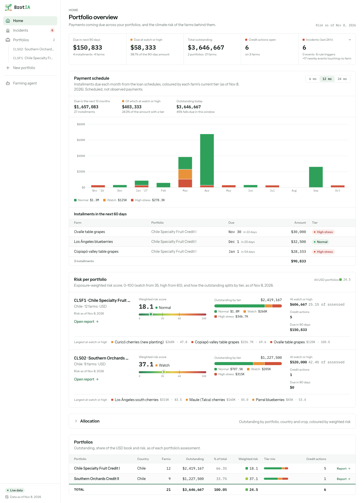

<p align="center">
  
</p>

# BrotIA

BrotIA shows a lender which farm loans in its portfolio are under climate stress, and why. It answers four
questions:

- which payments coming due sit on farms under climate stress;
- why each loan is flagged, with every driver's value, normal, source and date;
- how much of the book is exposed, read like an investment table (share of the book × risk score);
- which recent fires, floods and water-scarcity decrees touched which loans.

From any loan, the lender can ask Suyana for a parametric cover quote, prefilled from the farm's own drivers.
BrotIA was built in 36 hours at the **MIT Energy and Climate Hack 2026** for the Suyana challenge. It runs on
real Chilean data: 21 orchards from the CIREN fruit cadastre, CR2MET and RAN weather, DGA decrees and
snowmelt, Sentinel-2 imagery and NASA FIRMS fires. The lenders, loans and payment schedules in the two
sample books are illustrative.

<p align="center">
  
</p>

## The repo at a glance

| Path | What |
|---|---|
| `app/` | The web app: React 18, Vite, Tailwind, zustand. Home, portfolio report, farm pages in tabs, wizard, farming agent panel |
| `service/` | The data and risk engine: FastAPI + DuckDB. Source wrappers, imagery pipeline, AI super-resolution, risk formula, events, insurance outbox, agent |
| `contracts/v1/` | The contract between app and service: [`CONTRACT.md`](contracts/v1/CONTRACT.md), shared `types.ts`, fixtures |
| `app/public/snapshot/` | The offline snapshot: both sample books, scored, with imagery (the app falls back to it when the service is down) |
| `docs/adr/` | [26 architecture decision records](docs/adr/README.md): every decision, the evidence behind it, and what it changes |
| `docs/data-discovery/` | The source catalog: what each dataset gives, how to reach it, its licence |
| `docs/v1-status.md` | What works end to end, what is approximate, and the demo guide |
| `docs/v1-screens/` | Screenshots of every screen, in demo order |
| `docs/design/` | The UI spec and the risk formula explainer |
| `pipeline/`, `.workflows/` | Early indicator prototypes, and the multi-agent scripts that ran data discovery and the v1 build |

```
 browser ──▶ app (Vite, :5190) ──▶ service (FastAPI, :8787) ──▶ DuckDB cache (service/data/clm.duckdb)
                 │                         │
                 │                         ├──▶ CIREN · CR2MET · RAN · DGA · Sentinel-2 (Planetary Computer)
                 │                         │    NASA FIRMS · GWIS · Copernicus DEM          (public sources)
                 │                         ├──▶ SEN2SR super-resolution (local, display only)
                 │                         └──▶ Anthropic API (farming agent, optional)
                 │
                 └──▶ app/public/snapshot/   (offline fallback when the service is unreachable)
```

## Run it

You need Node 20+, Python 3.12 and [uv](https://docs.astral.sh/uv/). Two terminals:

```bash
# 1. Service (http://localhost:8787/health)
cd service
uv venv --python 3.12 .venv && uv pip install --python .venv/bin/python -r pyproject.toml --group dev   # once
CLM_FIXTURE_FALLBACK=0 .venv/bin/python -m uvicorn app.main:app --port 8787

# 2. App (http://localhost:5190; strict port, the service's CORS allows only 5190)
cd app
npm install   # once
npm run dev
```

The app loads both sample books on its first start. Three ways to run it:

| Mode | How | Data |
|---|---|---|
| Live | Both terminals above | Real sources, fetched and cached in DuckDB. A farm the service has never seen takes minutes the first time (five years of Sentinel-2), under a second after |
| Offline | `npm run dev` only, or stop the service | `app/public/snapshot/`, labelled "Offline snapshot of <date>". The agent, CIREN search and new portfolios need the live service |
| Agent | Set `ANTHROPIC_API_KEY` for the service (`export`, or one line in the gitignored `service/.env`) | `GET /health` reports `agentAvailable: true`. The key never reaches the app |

Refresh the offline snapshot with the service running:

```bash
curl -X POST http://localhost:8787/snapshot/export -H 'Content-Type: application/json' -d '{"asOf":"2026-11-08"}'
```

Every service setting (`CLM_OFFLINE`, `CLM_DB_PATH`, the model id, the background fetchers) is listed in
[`service/README.md`](service/README.md).

## Every check

| Command | Where | What it proves |
|---|---|---|
| `npm run typecheck` | `app/` | Strict TypeScript |
| `npm test` | `app/` | Domain rules, zod schemas against the contract fixtures, state, data client; `types.ts` is a byte-for-byte copy of the contract's |
| `npm run build` | `app/` | Typecheck, then the production build |
| `.venv/bin/python -m pytest` | `service/` | Sources, imagery, risk formula, events, rules, agent grounding, insurance outbox, snapshot |
| `service/.venv/bin/python app/scripts/e2e_check.py live` | repo root | The browser suite against the running app and service: every screen, every tab, phone width; screenshots into `docs/v1-screens/` |
| `service/.venv/bin/python app/scripts/e2e_check.py offline` | repo root | The same path with every request to the service blocked, from the snapshot |

## How a loan is scored

Each farm is scored at its current growth stage, inside its own 35 km² zone, against its own history and
its eight nearest orchards of the same crop.

```
Risk = 100 · min(1, base · (1 + c·G))
base = ½ · (a·C + b·D)/(a + b) + ½ · max(C, D)
C    = 1 − ∏ₚ (1 − sₚ(crop, stage) · xₚ(crop))
```

- **C, climate and water:** frost, heat, harvest rain, water supply, chill, vigour, abandonment. Each peril is
  weighted by the crop's sensitivity at its current stage (`s`), and its severity (`x`) is measured on the crop's
  own FAO thresholds. One frost night hits a blueberry in bloom fully and a dormant walnut not at all.
- **D, disasters:** burned area, floods, official emergency and water-scarcity declarations.
- **G, geography:** frost pockets, fire recurrence, the basin's decree history. It amplifies; it never acts alone.
- **The max term** lets one severe peril reach "high" on its own.

The weights (`a` 0.65, `b` 0.35, `c` 0.30) are expert defaults, editable per crop, zone and farm, with an
audit trail. They are not yet calibrated against losses.

Three trust rules hold everywhere:

| Rule | What it means |
|---|---|
| AI pixels are for viewing | SEN2SR upscales Sentinel-2 from 10 m to 2.5 m for display; every score uses the native 10 m data, and every frame is labelled observed, interpolated or AI-enhanced |
| Every value has provenance | Source, observed date, fetched date, resolution and licence tier; a missing value is shown as not available, never filled in |
| A coarse map can be overruled | A burned-area polygon is checked against the farm's own pixels; abandonment needs a collapse with no recovery |

The farming agent can only propose thresholds that its own 14-season backtest produced, and nothing changes
until a person applies them. A cover request to Suyana goes to an outbox the lender's team forwards; nothing
is sent automatically ([ADR-0025](docs/adr/0025-insurance-request-handoff-to-suyana.md)).

## Decisions

Every definition the team agreed on is an ADR in [`docs/adr/`](docs/adr/README.md): product and risk
definitions (0001, 0013), the data architecture (0002), each data family (0004 to 0010), the as-built
imagery, weather and risk engines (0014 to 0019), the agent (0020), the brand and information architecture
(0024), the insurance hand-off (0025) and the second sample book (0026).

## Status

Version 1.1, as demoed on 8 November 2026. The full picture, including what is fallback, estimated or not
built, is [`docs/v1-status.md`](docs/v1-status.md).

- **Works end to end** on real data for 21 orchards in Chile, live and offline.
- **Not validated against defaults.** No yield or repayment history was available; the signals were checked,
  not the losses.
- **Next:** combine the climate score with repayment history to estimate the probability of default,
  back-test against historical outcomes, calibrate the weights against insured losses, and run a
  one-season pilot with a lender.

## Team

Rafael Ferrada · Josefina Larrain · Cristian Vildosola · Fernanda Villablanca

## License

Copyright © 2026 Rafael Ferrada, Josefina Larrain, Cristian Vildosola and Fernanda Villablanca.
**All rights reserved.** This repository is shared for evaluation only; no licence is granted to use, copy,
modify or distribute it without written permission. Third-party data, models and marks (including the
Suyana name and logo) belong to their owners. See [`LICENSE`](LICENSE).
